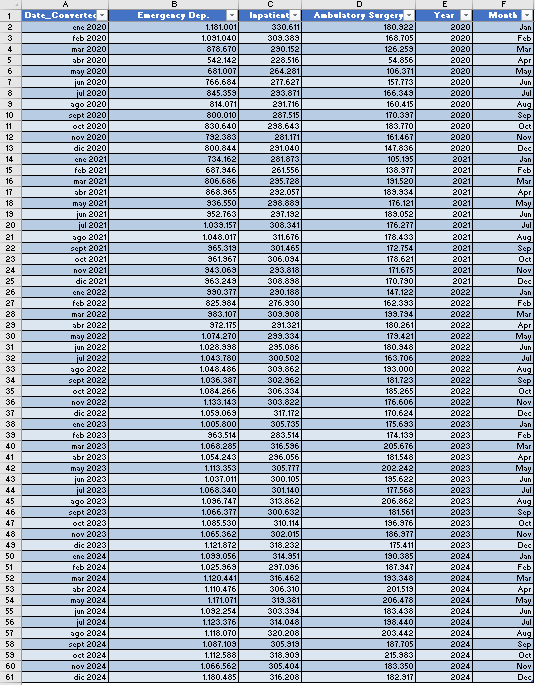
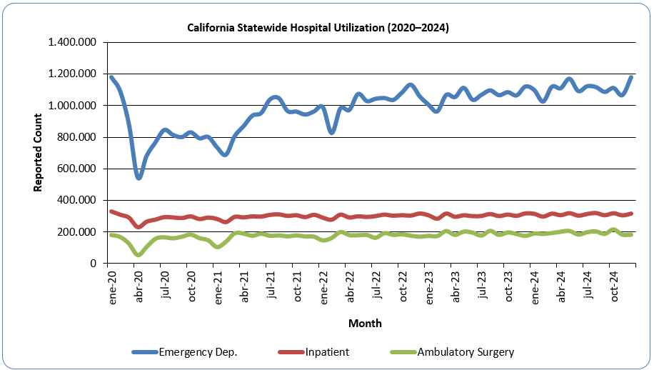
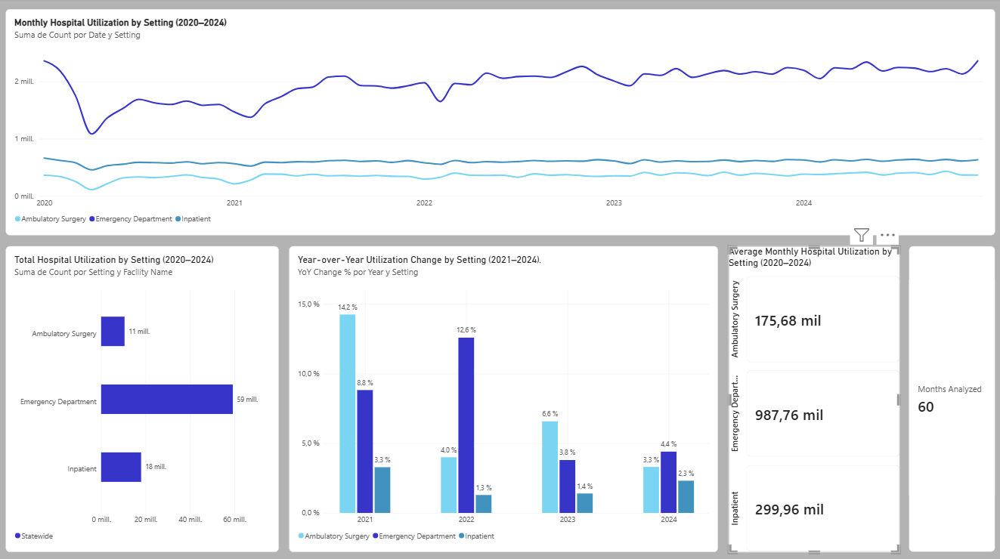

# California Hospital Utilization Analytics (2020–2024)

> **Project status:** Completed. The Excel workbook and Power BI report were saved, closed, reopened, and checked. Statewide annual totals, cumulative changes from 2020 to 2024, annual year-over-year (YoY) changes, and monthly month-over-month (MoM) changes for March–May 2020 were validated using BigQuery and reconciled with the Power BI visuals where applicable.

## 1. Project Overview

This project analyzes California hospital utilization from January 2020 through December 2024 using the Hospital Utilization Trends dataset published by the California Department of Health Care Access and Information (HCAI).

The workflow combines Excel for data preparation and validation, Google BigQuery SQL for data-quality checks and time-series calculations, and Power BI for data modeling and visualization.

The analysis focuses on three service settings:

- Emergency Department
- Inpatient
- Ambulatory Surgery

### Objectives

- Analyze monthly utilization trends across hospital service settings.
- Compare statewide utilization volumes and annual changes.
- Examine facility reporting coverage and facility-level differences.
- Identify data-quality issues and methodological limitations.
- Build a reproducible healthcare analytics workflow and communicate findings through a dashboard.

## 2. Data Source and Structure

| Attribute | Description |
|---|---|
| Dataset | Hospital Utilization Trends, 2020–2024 |
| Publisher | California Department of Health Care Access and Information (HCAI) |
| Source file | `hospital-utilization-trends_2020-2024.csv` |
| Reporting period | January 2020–December 2024 |
| Distinct monthly periods | 60 |
| Original records | 64,997 |
| Original columns | 5 |
| Service settings | Inpatient, Emergency Department, Ambulatory Surgery |
| Data type | Aggregated utilization counts, not patient-level records |

The dataset contains both statewide aggregate records and individual-facility observations. These represent different aggregation levels and must be analyzed separately.

### Original fields

| Field | Description |
|---|---|
| `Date` | Reporting month, originally represented by labels such as `20-Apr` |
| `Facility Name` | Facility name or statewide aggregate label |
| `System` | Hospital system identifier or statewide aggregate label |
| `Setting` | Hospital service setting |
| `Count` | Reported utilization count |

## 3. Data Preparation and Excel Workflow

The original CSV was imported into Excel for source inspection, preparation, exploratory analysis, and validation. Month labels such as `20-Apr` were converted into standardized monthly dates to support chronological sorting and time-based comparisons.

The workflow included:

1. Inspecting the source columns, values, and reporting period.
2. Converting source month labels into standardized monthly dates.
3. Preserving source fields and documenting derived fields.
4. Separating statewide aggregate records from individual-facility records.
5. Checking duplicate rows, key uniqueness, missing system identifiers, and reporting coverage.
6. Reviewing monthly trends and facility-level comparisons.
7. Organizing the workbook into analysis and quality-control worksheets.
8. Adjusting the `Monthly_Trends` chart to show quarterly axis labels for readability while retaining the underlying monthly data.

### Excel workbook structure

| Worksheet | Purpose |
|---|---|
| `Project_Notes` | Project scope, data sources, methodology, and limitations |
| `Source_Data` | Original records and documented derived fields |
| `Monthly_Trends` | Monthly statewide utilization trends by setting |
| `Facility_Comparison` | Facility-level volumes and reporting metrics |
| `Facility_Coverage` | Distinct reporting months by facility and setting |
| `Data_Quality` | Data-quality checks, findings, and limitations |
| `Reconciliation` | Comparison of facility aggregates with statewide reported totals |

All transformations remain traceable to the original dataset. The Excel workbook was saved and reopened successfully after the final chart adjustment.

### Excel evidence

**Monthly utilization table**



**Monthly utilization chart**



## 4. Methodological Decisions and Data Quality

### 4.1 Statewide versus facility-level records

Statewide records are identified using both conditions:

- `Facility Name = 'Statewide'`
- `System = 'Statewide'`

Statewide trend and annual analyses use statewide aggregate records only. Facility-level comparisons exclude statewide aggregate records and exclude null facility names where appropriate.

Statewide totals and individual-facility records must never be summed together. Doing so combines aggregate values with observations already represented by those totals and double-counts utilization.

### 4.2 Reporting coverage

Temporal coverage is calculated using distinct reporting months rather than raw row counts. The dataset contains 60 distinct monthly dates overall; this does not prove that every facility reported in every month.

Facility-level coverage must be interpreted within the selected service setting. Missing facility-month combinations are not automatically treated as zero utilization and do not, by themselves, prove that a facility was closed.

### 4.3 Missing system identifiers

Missing `System` values are retained as missing. No system affiliation is inferred without supporting evidence.

### 4.4 Small-count suppression

HCAI's privacy-protection rules indicate that small counts may be suppressed and represented by the value `11`. Therefore, `Count = 11` may represent a suppressed value rather than exactly 11 encounters.

These records are retained in the analysis and are not silently removed or treated as precise counts. The value `11` should be interpreted cautiously, particularly in facility-level comparisons and analyses involving small counts.

### 4.5 Initial validation baseline

The initial Excel validation recorded the following:

| Check | Result |
|---|---:|
| Source records | 64,997 |
| Distinct reporting months | 60 |
| Statewide records | 180 (60 months × 3 settings) |
| Fully duplicated rows | 0 |
| Duplicate keys for `Date + Facility Name + Setting` | 0 |
| Records with missing `System` | 18,419 |
| Records where `Count = 11` | 1,692 |

Initial BigQuery checks also returned 64,997 rows, 60 distinct date labels, three settings, no missing dates, no missing settings, no missing counts, no counts failing integer conversion, and no negative counts.

The separate BigQuery audit of `Count = 11` found:

| Setting | Records with `Count = 11` | Total records | Share |
|---|---:|---:|---:|
| Ambulatory Surgery | 880 | 19,500 | 4.51% |
| Inpatient | 812 | 26,565 | 3.06% |
| Emergency Department | 0 | 18,752 | 0.00% |

These figures are the recorded validation baseline. Basic completeness and type checks do not prove that every value is semantically correct or that every facility reports in every month.

## 5. BigQuery and SQL Analysis

The CSV was imported into Google BigQuery with automatic schema detection.

| Attribute | Value |
|---|---|
| Project ID | `project-64ca764a-0f3f-4a31-b12` |
| Dataset | `health_analytics` |
| Table | `hospital_utilization_v2` |

### 5.1 SQL scripts

The `sql/` directory contains four reusable BigQuery Standard SQL scripts:

| Script | Purpose |
|---|---|
| `01_data_quality_checks.sql` | Validates completeness, numeric values, duplicate keys, and small-count patterns |
| `02_monthly_trends.sql` | Calculates statewide monthly totals, MoM changes, and largest monthly increases and declines |
| `03_annual_trends.sql` | Calculates annual totals, YoY changes, and cumulative changes from 2020 to 2024 |
| `04_facility_analysis.sql` | Examines facility-level utilization totals and reporting coverage |

The [`sql/README.md`](sql/README.md) documents the individual scripts, execution workflow, assumptions, and limitations.

### 5.2 Date parsing

The original month labels were parsed into dates using BigQuery's safe date-parsing function:

```sql
SAFE.PARSE_DATE('%y-%b', Date)
```

For example, `20-Apr` becomes `2020-04-01`, enabling chronological sorting, monthly aggregation, and date-based comparisons.

### 5.3 SQL techniques used

- `COUNT`, `COUNT(DISTINCT ...)`, and `COUNTIF` for validation.
- `SUM`, `AVG`, `GROUP BY`, and `ORDER BY` for aggregation.
- `SAFE.PARSE_DATE` and `EXTRACT` for date handling.
- Common table expressions (`WITH`) to organize analytical steps.
- `LAG()` window functions for month-over-month and year-over-year comparisons.
- `SAFE_CAST` and `SAFE_DIVIDE` for defensive conversion and division.
- Annual comparisons and facility reporting coverage.
- Explicit statewide filters to prevent mixing aggregation levels.

### 5.4 Calculation definitions

**Month-over-month percentage change**

\[
\text{MoM Change \%} =
\frac{\text{Current Month}-\text{Previous Month}}
{\text{Previous Month}}\times100
\]

**Year-over-year percentage change**

\[
\text{YoY Change \%} =
\frac{\text{Current Year Total}-\text{Previous Year Total}}
{\text{Previous Year Total}}\times100
\]

**Cumulative change from 2020 to 2024**

\[
\text{Cumulative Change \%} =
\frac{\text{2024 Total}-\text{2020 Total}}
{\text{2020 Total}}\times100
\]

These are distinct measures. Annual YoY changes must not be confused with the cumulative change across the full 2020–2024 period.

## 6. Power BI Model and Dashboard

The Power BI report is saved as `California_Hospital_Utilization_Analytics.pbix`.

The main data table in the model is `hospital-utilization-trends_2020-2024(1)`. The model contains `Count`, `Date`, `Facility Name`, `Setting`, and `System`. The `Date` column was corrected in Power Query and is used for chronological analysis. A calculated `Year` column supports annual comparisons.

The `Months Analyzed` measure returns 60:

```dax
Months Analyzed =
DISTINCTCOUNT(
    'hospital-utilization-trends_2020-2024(1)'[Date]
)
```

### 6.1 Final dashboard visuals

1. **Monthly Hospital Utilization by Setting (2020–2024):** Line chart comparing monthly counts for all three settings.
2. **Total Hospital Utilization by Setting (2020–2024):** Bar chart comparing statewide total counts by setting.
3. **Average Monthly Hospital Utilization by Setting (2020–2024):** KPI cards showing average monthly statewide counts by setting.
4. **Months Analyzed:** KPI card showing 60 distinct reporting months.
5. **Year-over-Year Utilization Change by Setting (2021–2024):** Chart comparing annual percentage changes by setting.

The separate `Monthly Emergency Department Utilization` chart and temporary diagnostic table were removed because the emergency-department series is already represented in the main monthly chart and the table was used for troubleshooting.

### 6.2 Filters and aggregation level

Statewide totals and average monthly statewide KPI cards use both filters:

- `Facility Name = Statewide`
- `System = Statewide`

This prevents facility-level rows from being added to statewide aggregate records.

### 6.3 Color palette and presentation

The main monthly and annual trend charts use consistent colors by setting:

- Emergency Department: `#176B87`
- Inpatient: `#8B5CF6`
- Ambulatory Surgery: `#E6A23C`

The total-volume bar chart retains a single color because category-specific colors could not be configured in the selected visual settings. This is a presentation limitation and does not affect the underlying calculations.

The duplicate X-axis title on the main monthly chart was removed. The dashboard layout and chart titles were reviewed. The PBIX was saved, closed, reopened, and checked successfully.

### Power BI dashboard preview



## 7. Validated Statewide Findings

### 7.1 Annual totals and cumulative change, 2020–2024

These statewide annual totals were calculated in BigQuery using only records where both `Facility Name = 'Statewide'` and `System = 'Statewide'`. They were checked against the Power BI totals.

| Setting | 2020 total | 2024 total | Cumulative change |
|---|---:|---:|---:|
| Emergency Department | 10,023,851 | 13,307,457 | +32.76% |
| Ambulatory Surgery | 1,785,120 | 2,334,952 | +30.80% |
| Inpatient | 3,444,532 | 3,738,290 | +8.53% |

### 7.2 Year-over-year change

| Year | Ambulatory Surgery | Emergency Department | Inpatient |
|---|---:|---:|---:|
| 2021 | +14.24% | +8.82% | +3.28% |
| 2022 | +4.00% | +12.58% | +1.29% |
| 2023 | +6.57% | +3.80% | +1.40% |
| 2024 | +3.30% | +4.40% | +2.31% |

The annual YoY calculations were produced in BigQuery using `LAG()` over annual totals for each setting. The results were compared with the Power BI YoY chart. Small differences of approximately 0.01–0.02 percentage points were observed in some displayed values, consistent with display and rounding precision; the trends and values matched to that precision.

### 7.3 Month-over-month change, March–May 2020

The following monthly changes were recalculated using statewide-only records and consistent setting-level aggregation.

| Setting | March 2020 vs. February | April 2020 vs. March | May 2020 vs. April |
|---|---:|---:|---:|
| Ambulatory Surgery | −25.16% | −56.55% | +93.91% |
| Emergency Department | −19.46% | −38.30% | +25.61% |
| Inpatient | −6.22% | −21.24% | +15.65% |

These values were calculated using the same setting and aggregation level across adjacent months.

### 7.4 Interpretation

- Emergency Department had the largest cumulative increase from 2020 to 2024 (+32.76%) and the largest absolute utilization total in both comparison years.
- Ambulatory Surgery increased by 30.80% over the same period. It also showed the largest monthly decline in April 2020 (−56.55%) and the largest rebound in May (+93.91%) among the three settings.
- Inpatient utilization increased by 8.53% cumulatively, a more moderate increase than the other settings.
- All three settings declined in April 2020 compared with March and increased in May compared with April.

These are descriptive findings about reported statewide utilization counts. They do not establish the causes of the changes, and a month-over-month rebound does not necessarily mean the series returned to its pre-decline level.

## 8. Limitations

1. **No pre-2020 baseline:** The dataset begins in January 2020 and cannot establish earlier utilization levels.
2. **Privacy suppression:** Values of 11 may represent suppressed counts rather than exact utilization.
3. **Aggregation grain:** Statewide totals and facility-level observations must not be summed together.
4. **Reporting coverage:** Incomplete facility reporting can make raw facility totals misleading; missing observations are not necessarily zero.
5. **Missing system identifiers:** Missing `System` values limit some system-level comparisons.
6. **Changes over time:** Reporting coverage or facility organization may affect comparisons.
7. **Descriptive analysis:** Trends and percentage changes do not establish causal explanations.
8. **Metric scope:** The dataset supports utilization analysis, not conclusions about mortality, readmissions, length of stay, costs, or patient-level outcomes.
9. **Suppression effects:** Counts recorded as 11 may affect interpretation of small values and aggregate comparisons.
10. **Percentage interpretation:** Relative changes should be considered alongside absolute counts and the previous period's value.

## 9. Final Quality Checklist

- [x] Source dataset size, fields, and reporting period documented.
- [x] Three service settings identified.
- [x] Date handling corrected in Power Query and Excel.
- [x] Statewide aggregate records distinguished from facility-level records.
- [x] Initial data-quality checks documented.
- [x] `Months Analyzed` measure returns 60.
- [x] Statewide totals for 2020 and 2024 reconciled between BigQuery and Power BI.
- [x] Cumulative changes for 2020–2024 recalculated and verified.
- [x] Annual YoY changes calculated in SQL and compared with Power BI.
- [x] March–May 2020 MoM changes recalculated using statewide-only records.
- [x] Main monthly, total-volume, KPI, and YoY visuals reviewed.
- [x] Statewide filters checked for statewide totals and average monthly KPI cards.
- [x] Duplicate X-axis title removed from the main monthly chart.
- [x] Excel `Monthly_Trends` chart labels set to quarterly intervals for readability.
- [x] Excel workbook saved, closed, reopened, and checked successfully.
- [x] Power BI report saved, closed, reopened, and checked successfully.
- [x] Four SQL scripts documented in `sql/README.md`.
- [x] Excel and Power BI screenshots included in the repository.

## 10. Reproducibility and Repository

To reproduce the analysis:

1. Obtain the original HCAI CSV dataset.
2. Import the data into Excel and BigQuery.
3. Run `sql/01_data_quality_checks.sql` to validate data quality and identify potential small-count suppression.
4. Parse month labels into dates and separate statewide records from facility-level observations.
5. Run `sql/02_monthly_trends.sql` for monthly trends and MoM changes.
6. Run `sql/03_annual_trends.sql` for annual totals, YoY changes, and cumulative changes.
7. Run `sql/04_facility_analysis.sql` for facility-level totals and reporting coverage.
8. Reconcile statewide SQL results against Power BI visuals before publishing findings.

### Repository contents

- `README.md` — project overview, workflow, findings, quality checks, and limitations.
- `sql/README.md` — SQL documentation and execution guidance.
- `sql/01_data_quality_checks.sql` — data-quality validation.
- `sql/02_monthly_trends.sql` — monthly trend analysis.
- `sql/03_annual_trends.sql` — annual trend analysis.
- `sql/04_facility_analysis.sql` — facility-level analysis.
- `California_Hospital_Utilization_Analytics.pbix` — Power BI report.
- Excel workbook — data preparation, analysis, and validation.
- `powerbi_dashboard_overview.png` — Power BI dashboard screenshot.
- `excel_monthly_trends_table.png` — Excel monthly trends table screenshot.
- `excel_monthly_trends_chart.png` — Excel monthly trends chart screenshot.

The Excel workbook and Power BI report were saved and reopened locally after final checks. The SQL scripts provide the documented analytical workflow. To reproduce the results, the original dataset and access to a suitable BigQuery environment are required.

## 11. Conclusion

This project demonstrates a healthcare analytics workflow combining Excel, BigQuery SQL, and Power BI. It covers data preparation, quality validation, temporal analysis, aggregation, and visualization while addressing a key methodological issue: statewide aggregates must remain separate from facility-level records.

The validated 2020–2024 comparison shows the largest cumulative increase in Emergency Department utilization, followed by Ambulatory Surgery, while Inpatient utilization grew more moderately. The monthly analysis identifies a decline across all three settings in April 2020 followed by a rebound in May. These findings are descriptive and should be interpreted in light of reporting coverage and the dataset's suppression policy.

The project is complete, with the analysis reconciled, the dashboard reviewed, and both working files saved and reopened successfully.

## Data Source Attribution

California Department of Health Care Access and Information (HCAI), *Hospital Utilization Trends, 2020–2024*. Dataset attribution and licensing should follow the terms stated on the official HCAI dataset page.
